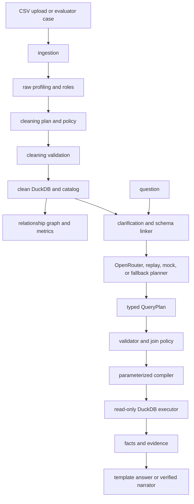

# Architecture

This is the code-accurate architecture for commit `7d4aa08d0673a03e5d27b667c2653b0632a5bdfa`.
The implementation is a single Python application with shared services used by both the
FastAPI routes and the batch evaluator.

## System diagram



## Module map

| Module | Responsibility | Main entry points |
|---|---|---|
| `app/ingestion` | File checks, encoding, CSV reading, raw registration | `validate_file`, `read_csv_as_strings`, `register_raw` |
| `app/profiling` | Statistics, profiles, issue detection | `profile_frame`, `detect_*` |
| `app/roles` | Role aliases, type/distribution scoring, ambiguity | `infer_roles`, `annotate_profile` |
| `app/cleaning` | Plan generation, transformations, policy, validation | `clean_dataset`, `validate_cleaning` |
| `app/relationships` | Key overlap, cardinality, graph, safe path policy | `discover_relationships`, `JoinPolicy` |
| `app/metrics` | Retail metric registry and role binding | `metric_definitions`, `bind_metric` |
| `app/query` | Typed plans, validation, compilation, execution, catalog | `validate_plan`, `compile_plan`, `execute_query` |
| `app/conversation` | Clarification, schema context, state/delta merge | `check_clarification`, `build_schema_context`, `merge_delta` |
| `app/agents` | LLM protocol, fallback rules, tools, narration | `LLMPlanner`, `FallbackPlanner`, `narrate` |
| `app/llm` | OpenRouter/mock/synthetic/cassette providers | `build_provider`, `OpenRouterProvider`, `CassetteProvider` |
| `app/evidence` | Facts, evidence bundle, answer templates, claim verification | `build_evidence`, `render_template`, `verify` |
| `app/services` | Shared pipeline/chat orchestration | `run_pipeline`, `ask` |
| `app/storage` | SQLite schema, owner-scoped repositories, artifact paths | `Database`, `Repository`, `ArtifactStore` |
| `app/orchestration` | Run state machine and single worker jobs | `RunStateMachine`, `JobRunner` |
| `app/api` | FastAPI upload, run, session, chat, trace, evidence routes | `create_run`, `chat`, `get_run` |
| `app/evaluation` | Tolerant case loading, comparisons, metrics, injection suite | `load_cases`, `path_metrics`, `run_suite` |

## Pipeline sequence: `run_pipeline()`

`app/services/pipeline.py` is the only pipeline entry point.

1. Reject an empty file list or duplicate logical names.
2. Hash each input and compute a run fingerprint from owner, files, cleaner/role/policy
   versions, policy, and approved step IDs.
3. Reuse an existing successful run for the same owner/fingerprint unless `force` is true.
4. Advance the state machine from `queued` to `ingesting`.
5. Register raw files, convert to UTF-8, read all values as strings, and persist structural
   rejects.
6. Profile raw frames and infer/annotate roles.
7. Build and execute the cleaning plan. Interactive review can stop at `needs_review`.
8. Write cleaned CSVs and parse-failure artifacts.
9. Re-read cleaned CSVs, clean them a second time, and compare profile hashes.
10. Validate row and column invariants, step metadata, parse-failure accounting, unresolved
    issues, and idempotency.
11. Profile clean frames, infer roles again, detect duplicate IDs, and discover clean/raw
    relationship graphs.
12. Write `run.duckdb`: typed `clean_<name>` tables and all-VARCHAR `raw_<name>` tables.
13. Persist catalog, profiles, issues, plan, graph, validation, result, trace, and SQLite
    documents. Finish as `completed` or `completed_with_warnings`.

The state machine allows:

```text
queued -> ingesting -> profiling -> planning -> cleaning -> validating
                                                     |         |
                                                     v         v
                                                needs_review  completed
                                                               or completed_with_warnings
```

Any active state can fail; terminal `failed`, `completed`, and
`completed_with_warnings` states cannot transition further.

## Chat sequence: `ask()`

`app/services/chat.py` loads an owner-scoped session and catalog, then:

1. returns an idempotent stored turn when an idempotency key matches;
2. trims the question to 500 characters and applies pending clarification;
3. runs the code clarification gate;
4. builds bounded schema context and creates `PlannerTools`;
5. asks `LLMPlanner` when a provider exists, otherwise uses `FallbackPlanner`;
6. permits one repair for parse/schema/tool-evidence errors;
7. applies the documented fallback default for over-conservative LLM clarification;
8. validates a `QueryPlan` against server-owned `ExecutionContext`;
9. compiles and executes read-only parameterized DuckDB SQL;
10. creates facts and an `EvidenceBundle`;
11. renders a deterministic template and optionally verifies narrator segments;
12. persists state, trace, evidence, and the complete chat turn.

The LLM can request only `get_schema`, `list_distinct`, `preview_join`, and
`get_metric_definition`. A filter on a string value requires `list_distinct`; a relationship
requires `preview_join`; an uncertain metric requires `get_metric_definition`. Missing
evidence produces `TOOL_EVIDENCE_MISSING` and one repair. Fallback planning performs the
same tools in code.

## Persistence

SQLite is initialized by `app/storage/database.py` with WAL and foreign-key pragmas. The
tables are:

| Table | Stored information |
|---|---|
| `runs` | owner, fingerprint, status, policy, warnings and errors |
| `dataset_versions` | raw/clean artifact path, hash, rows and parent |
| `artifacts` | artifact kind, path, hash and size |
| `profiles` | raw/clean profile JSON and hash |
| `issues` | issue JSON per run |
| `role_bindings` | inferred role and confidence |
| `cleaning_steps` | step JSON and status |
| `relationship_graphs` | graph JSON and graph version |
| `sessions` | owner, run and serialized conversation state |
| `chat_turns` | question, plan, validation, execution summary, evidence and answer |
| `evidence` | serialized evidence bundles |
| `traces` | ordered component events and durations |
| `jobs` | async run status and retry attempts |
| `advisor_cache`, `llm_cache` | optional provider responses |

Repository methods require `owner_id` and raise `ISOLATION_VIOLATION` when an object is not
owned by the caller. Artifact files are additionally scoped by owner and run ID.

## Contracts and state

`app/schemas.py` contains pipeline contracts. `app/query/schemas.py` contains `QueryPlan`,
`PlanDelta`, `PlannerOutput`, `ValidationResult`, `ExecutionResult`, `Fact`,
`EvidenceBundle`, `ChatResult`, `ConversationState`, `ToolLog`, and narrator contracts.
LLM-facing Pydantic models use `extra="forbid"`. Dataset versions, owners, graph versions,
and trace IDs are application-owned.

## Error codes raised in code

The declared `AppError` codes are:

`INVALID_FILE`, `SCHEMA_INFERENCE_FAILED`, `CLEANING_VALIDATION_FAILED`,
`UNKNOWN_RELATIONSHIP`, `UNSAFE_JOIN`, `INVALID_QUERY_PLAN`, `UNSUPPORTED_QUERY`,
`CLARIFICATION_REQUIRED`, `QUERY_TIMEOUT`, `LLM_TIMEOUT`, `LLM_RATE_LIMITED`,
`INVALID_LLM_JSON`, `ISOLATION_VIOLATION`, `INTERNAL_ERROR`, and `CASE_INPUT_INVALID`.

The validator also emits non-exception issue codes such as `TOOL_EVIDENCE_MISSING`,
`UNKNOWN_COLUMN`, `TYPE_MISMATCH`, `SCOPE_VIOLATION`, `STAGE_RULE`, and
`LIMIT_EXCEEDED`. HTTP route mappings return 400 for invalid input, 404 for isolation
failures, and 422 for unsupported or clarification outcomes; unlisted errors return 500.

## Artifact layout

```text
<artifacts>/
  <owner>/
    runs/<run_id>/
      datasets/<logical_name>/
        raw.csv
        cleaned.csv
        raw_profile.json
        cleaned_profile.json
        structural_rejects.json
        parse_failures.json
      cleaning/issues.json
      cleaning/cleaning_plan.json
      cleaning/validation.json
      relationships/raw_graph.json
      relationships/clean_graph.json
      catalog.json
      run.duckdb
      traces/pipeline_trace.json
      run_result.json
```

The evaluator uses a case-specific artifact root and writes one `meta.sqlite` at that root.
The injection suite uses its own `_injection` subdirectory.
